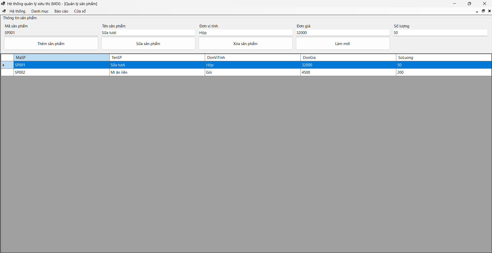
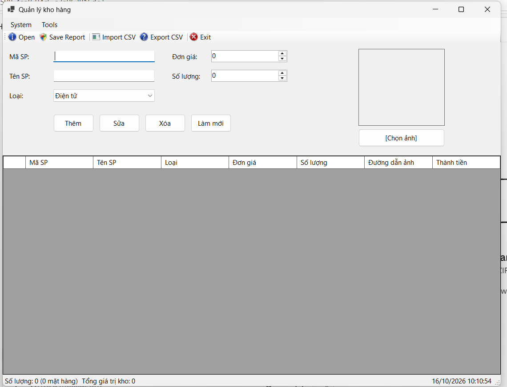
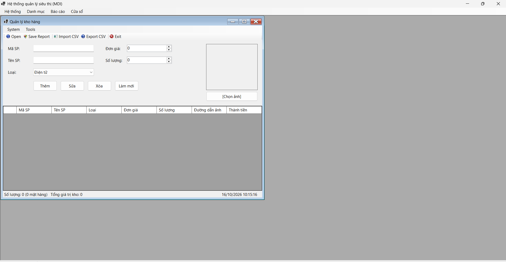

# BÁO CÁO BÀI TẬP / ĐỒ ÁN

## THÔNG TIN SINH VIÊN

- **Họ và tên:** Dương Ngô Hạnh
- **Mã số sinh viên:** 24810310206
- **Lớp:** D19-CNPM3
- **Tên môn học:** Lập trình C# / Windows Forms
- **Tên bài tập:** Bài kiểm tra số 02

---

## KẾT QUẢ THỰC HÀNH

### 1. Ảnh màn hình giao diện chính

### 2. Ảnh màn hình chức năng thực thi / kết quả

### 3. Ảnh màn hình quản lý danh mục thiết bị điện tử

> Lưu ý: Theo yêu cầu mẫu, mục 3 nên là ảnh kiểm tra lỗi (Validation). Ảnh hiện có là giao diện quản lý thiết bị; hãy chụp thêm ảnh thật khi nhập thiếu dữ liệu và chương trình hiển thị thông báo lỗi, sau đó thay ảnh này bằng `validation_error.png` và cập nhật đường dẫn bên dưới.

<!-- Khi đã có ảnh Validation, thay mục 3 bằng:
### 3. Ảnh màn hình kiểm tra lỗi (Validation)

-->

---

## MÔ TẢ CHƯƠNG TRÌNH

Chương trình được xây dựng bằng C# Windows Forms, sử dụng giao diện MDI để tổ chức các chức năng quản lý trong hệ thống siêu thị.

Các chức năng thể hiện qua giao diện:
- Quản lý danh mục sản phẩm.
- Hiển thị danh sách sản phẩm bằng DataGridView.
- Thêm, sửa, xóa sản phẩm và làm mới dữ liệu nhập.
- Quản lý danh mục thiết bị điện tử.

## CÔNG NGHỆ SỬ DỤNG

- Ngôn ngữ: C#.
- Giao diện: Windows Forms.
- Môi trường phát triển: Visual Studio.
- Quản lý phiên bản: Git.
- Lưu trữ mã nguồn: GitHub.

## KẾT LUẬN

Bài tập giúp củng cố kiến thức về thiết kế giao diện Windows Forms, xử lý sự kiện, hiển thị dữ liệu bằng DataGridView và tổ chức các cửa sổ con trong giao diện MDI.
